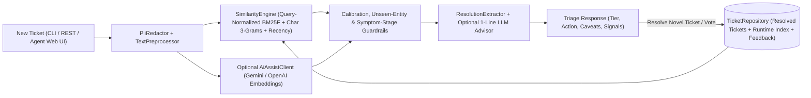

# Solution Design: Solari Support Ticket Similarity Assistant

## 1. Problem Restated

Solari Analytics (~400 employees) handles roughly **150 incoming B2B retail-analytics support tickets per day**, with substantial ticket growth projected over the next 12 months as new customers onboard. Today, support agents triage tickets without fast visibility into whether a similar issue has already been diagnosed and resolved. This creates two compounding operational costs:

1. **Elevated Handle Time (MTTR):** Agents repeatedly re-investigate solved issues (expired OAuth/API tokens, empty-filter chart states, role permission defaults) from scratch.
2. **Inconsistent Customer Guidance:** Two agents handling the same underlying product behavior weeks apart can give conflicting explanations or workarounds, eroding customer trust.

Our goal is to deliver an **agent-in-the-loop triage assistant** that immediately surfaces high-precision past resolved tickets, highlights actionable resolution steps, warns when a past match differs in failure stage, and stays quiet when an issue is genuinely novel.

---

## 2. Explicit Assumptions & Rationale

Because Jamie's kickoff ask is intentionally open-ended, v1 anchors on five explicit engineering assumptions:

| Dimension | Assumption | Why It Matters |
| :--- | :--- | :--- |
| **Historical & Growth Scale** | ~1–2 years of history today (**50k–100k resolved tickets** at 150/day), growing **3x–5x** over 12–18 months (450–750 tickets/day; **~250k–350k corpus**). | 750 tickets/day across business hours is **< 0.5 QPS average (< 5 QPS peak)**. An in-memory inverted index (backed by Postgres in prod) serves 300k short tickets in **< 20 ms** on a single JVM node—standing up a distributed vector cluster on Day 1 would be unnecessary operational overhead. |
| **What "Similar" Means** | Shared **product surface + symptom + reusable resolution path**, calibrated into 3 tiers: `STRONG` (>= 52%), `RELATED` (34%–52% or stage-divergent), and `NONE` (< 34%). | Sharing generic words (`"customer"`, `"error"`) or broad category (`billing`) is not enough. Agents need to distinguish an exact repeat (`NT-2`, `NT-3`) from a partial workflow neighbor (`NT-1`) or a brand-new integration (`NT-4`). |
| **Latency Budget** | **< 200 ms p95** for core retrieval (< 10 ms local); **< 1.5 s** if optional LLM synthesis is enabled. | Suggestions must populate as soon as an agent opens a ticket in Zendesk/Intercom without blocking triage or failing if an external AI provider is degraded. |
| **Corpus Eligibility & Safety** | Only `status == "resolved"` tickets with non-empty `resolution_notes` are indexed; common PII patterns (emails, bearer/API tokens, card numbers) are scrubbed on load. | Surfacing open/abandoned tickets wastes agent time, and raw historical notes in B2B support often contain customer emails or credentials that should not leak across accounts. |
| **Human-in-the-Loop Workflow** | Internal agent decision-support only (never auto-sent to customers), paired with 1-click 👍/👎 feedback and live ticket indexing. | Protects customers from wrong automated replies while capturing ground-truth relevance labels from Day 1. |

---

## 3. Proposed Architecture & Retrieval Approach

### Core Retrieval Pipeline (Java 17)
1. **Domain-Aware Text Normalization (`TextPreprocessor`)**:
   - Fixes specific defects in the starter kit's `ticket_utils.py`: expands contractions and strips possessives *before* punctuation removal (preventing orphan `'s` and `'t` tokens from matching unrelated tickets), unifies SaaS compounds (`"log in"` -> `"login"`, `"re-sync"` -> `"resync"`, `"two-factor"` -> `"2fa"`), removes support boilerplate (`"customer"`, `"says"`), applies lightweight suffix stemming, and canonicalizes domain synonyms (`"nothing"`/`"empty"` -> `"blank"`, `"twice"`/`"double"` -> `"duplicate"`).
2. **Field-Weighted Query-Normalized BM25F + Character 3-Grams (`SimilarityEngine`)**:
   - Indexes historical fields with explicit signal weights: `subject` (`3.0x`), `tags` (`2.5x`), `category` (`1.2x`), `description` (`1.0x`), and `resolution_notes` (`0.35x`—low enough that symptom words lead, high enough that diagnostic terms like `"Okta"` or `"SAML"` match).
   - **Query-Maximum Normalization for Cold-Start Precision:** Raw BM25 scores are normalized against the maximum possible query score, where unseen out-of-vocabulary subject nouns (such as `"Snowflake"` and `"warehouse"` in `NT-4`) carry full corpus-max IDF weight in the denominator. When a ticket's core subject entity does not exist in history, its normalized confidence naturally drops (`25.2%` on `NT-4`), cleanly triggering `No Strong Historical Match` while keeping `sync` playbooks (`T-1105`, `T-1101`) available in a collapsed reference drawer.
   - Blends `0.84 * BM25F + 0.14 * CharTrigramCosine + 0.02 * RecencyDecay` inside an immutable, lock-free `volatile IndexSnapshot`.
3. **Symptom-Stage Guardrail & Action Extraction (`ResolutionExtractor`)**:
   - Detects stage mismatches where an incoming ticket reports **non-delivery** (`"password reset email never arrives"` in `NT-1`) while the matched ticket occurred **post-receipt** (`"via the email link"` in `T-1001`), automatically downgrading `STRONG` -> `RELATED` and displaying an explicit caveat.
   - Separates historical resolutions into **Support Playbooks** vs. **Prior Engineering Fixes** so agents know whether to guide the customer or verify a code regression.
4. **Optional Pluggable AI Bonus Track (`AiAssistClient`)**:
   - When `GEMINI_API_KEY` or `OPENAI_API_KEY` is set and `--ai` (or the UI toggle) is enabled, blends cached dense embeddings (`0.65` entity-aware lexical + `0.35` semantic cosine) and generates a 1-sentence tailored triage note. When unconfigured, the system runs 100% locally in **2–5 ms** with zero network calls.

---

## 4. Main Trade-Offs Considered

1. **Calibrated Hybrid BM25F vs. Pure Dense Embeddings:**
   - *Trade-off:* Pure dense embeddings handle open-ended paraphrasing well, but off-the-shelf embedding models cluster `"Snowflake warehouse integration failing"` (`NT-4`) tightly (~0.78–0.83 cosine) with `"HubSpot integration failing with auth error"` (`T-1105`) because both share the template *"<SaaS Connector> failing with error"*.
   - *Decision:* Lead with entity-sensitive Query-Normalized BM25F + char 3-grams, and fuse embeddings at `0.35` weight only as an optional signal. This preserves exact product/error-code discrimination (`Snowflake`, `Okta`, `429`, `500`), runs offline with zero API cost, and gives agents transparent matched-keyword chips.
2. **Precision-First Thresholding vs. Always Returning Top-3:**
   - *Trade-off:* Always showing 3 tickets maximizes recall on edge cases, but surfacing irrelevant matches (e.g., showing `Account locked` on a Snowflake sync ticket) trains agents to ignore the sidebar within a week.
   - *Decision:* Enforce calibrated tiers (`STRONG >= 52%`, `RELATED >= 34%`) plus an unseen-subject-entity check, demoting weak matches into an explicitly labeled collapsible section when no strong match exists.
3. **Zero-Dependency Java 17 Standard Library vs. Spring Boot + External DB:**
   - *Trade-off:* Spring Boot + Postgres/Lucene offers turn-key production plumbing, at the cost of heavy dependencies and setup friction for a 3–4 hour v1 prototype.
   - *Decision:* Build on pure JDK 17 (`HttpServer`, `HttpClient`, immutable `record` models, custom RFC-8259 `JsonCodec`, Maven `pom.xml` + `./run.sh`). It compiles in < 2 seconds on any machine with zero external JARs, while cleanly isolating `TicketRepository` and `SimilarityEngine` interfaces for drop-in Postgres/Lucene replacement.

---

## 5. What We Would Do Next (More Time, Data, or Budget)

1. **Native Helpdesk Sidebar Integration (Next 1–2 Weeks):** Embed via Zendesk/Intercom webhook + sidebar app (`POST /api/match` on ticket open, auto-indexing resolved tickets via ticket-closed webhooks) so agents never leave their existing queue.
2. **Durable Storage & Incremental Indexing (At 50k+ Tickets):** Swap `TicketRepository`'s JSON backing store for **PostgreSQL (`pg_trgm` + `tsvector` + `pgvector`)**, keeping sub-30 ms hybrid retrieval with ACID durability, customer-tier metadata filtering, and zero index-rebuild downtime.
3. **Feedback-Driven Calibration & Evaluation Harness (With More Data):** Use the captured `/api/feedback` 👍/👎 logs and ticket-link events to build a labeled golden dataset (measuring `Precision@1`, `NDCG@3`, and false-positive rate on novel tickets) and tune field weights (`BM25F` + synonym expansion from Solari's actual ticket vocabulary).
4. **Resolution Staleness & Product-Release Versioning:** Tag resolutions that correspond to shipped bug fixes with release dates; if no similar ticket recurs for 60 days, down-rank old bug-fix tickets relative to evergreen customer configuration playbooks, or flag new matches as **Suspected Regression** for Engineering.
5. **Cold-Start Trend Detection (More Budget):** Cluster unmatched (`NONE`) tickets weekly—if 5 customers hit `"Snowflake warehouse connection error"` in 48 hours, automatically alert Support Leads to author a canonical playbook before volume spikes.
